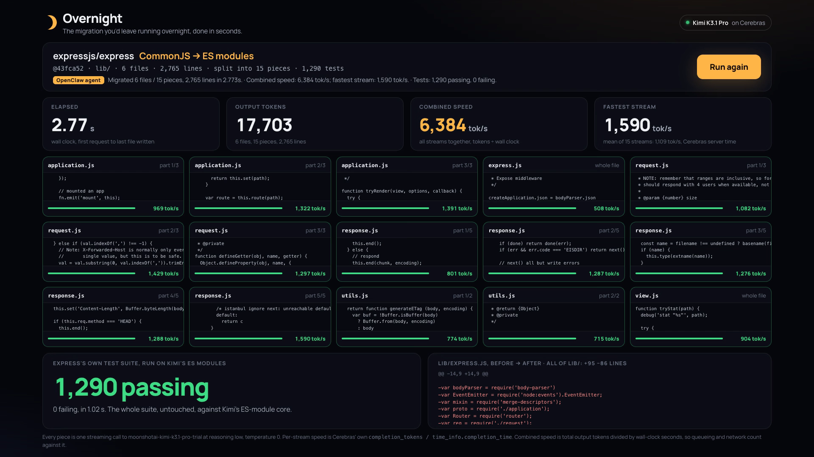

<h1 align="center">🌙 Overnight</h1>

<p align="center">
  <b>The migration you'd leave running overnight, done in seconds.</b><br>
  An OpenClaw agent moves Express's core from CommonJS to ES modules with Kimi K3.1 Pro on Cerebras in 2.77 s,
  and Express's own 1,290 tests pass against the result.
</p>

<p align="center">
  <a href="video/overnight-demo.mp4">▶ Watch the demo</a> ·
  <a href="#run-it">Run it</a> ·
  <a href="#how-it-works">How it works</a> ·
  <a href="#how-the-numbers-are-measured">How it's measured</a>
</p>

<p align="center">
  
  
  
  
  
</p>

<p align="center">
  
</p>

<p align="center">
  <sub>Built with <a href="https://www.cerebras.ai">Cerebras</a> inference ·
  <a href="https://www.kimi.com">Kimi K3.1 Pro</a> by <a href="https://www.moonshot.ai">Moonshot AI</a> ·
  <a href="https://github.com/openclaw/openclaw">OpenClaw</a></sub>
</p>



## At a glance

One recorded run, start to finish (take d-1, the run in the video):

| | |
|---|---|
| Target | [expressjs/express](https://github.com/expressjs/express) at `43fca52`, all of `lib/`: 6 files, 2,765 lines |
| Work | split into 15 pieces, all 15 sent to Kimi K3.1 Pro at the same moment |
| Wall clock | **2.77 s** from the first request to the last file written |
| Output | 17,703 tokens of rewritten JavaScript |
| Combined speed | **6,384 tok/s**, all streams together (tokens ÷ wall clock) |
| Fastest single stream | 1,590 tok/s; mean of the 15: 1,109 tok/s (Cerebras server time) |
| Proof | Express's own suite: **1,290 passing, 0 failing**, with `index.js` and all 89 test files untouched |

The diff is what a careful human would write: `require` becomes `import`, `module.exports` becomes
`export default`, local paths gain `.js`, and every other line is byte-for-byte the same
(+95 / −86 lines across the six files in that run).

## How it works

1. **You ask the OpenClaw agent.** The page's button sends one request to an OpenClaw agent running
   Kimi K3.1 Pro on Cerebras. The agent has the [`overnight` skill](skills/overnight/SKILL.md): it runs
   `node migrate.mjs --json` with its exec tool and answers from the JSON.
2. **Split.** [`migrate.mjs`](migrate.mjs) cuts every file at top-level boundaries (a blank line
   followed by a statement in column 0), never above the last `require`, into pieces of about 5,000
   characters. Express's six files become 15 pieces.
3. **Fan out.** Every piece goes to Kimi at once, one streaming call each, with the same short set of
   rules (temperature 0, reasoning low). Pieces after the first see the file's `require` lines as
   context, so every worker makes the same naming decisions.
4. **Check.** Each piece must return every line it should have copied untouched, and every exported
   name must still be exported. A piece that fails is converted again before anything is written.
5. **Prove.** The pieces are joined, `lib/package.json` gets `{"type": "module"}`, and Express's own
   test suite runs against the new core. The tests stay CommonJS: each converted module also exports
   its value as `'module.exports'`, so Node's `require()` of an ES module hands old callers exactly what
   they had before.

The page listens to every event (piece started, each token, piece checked, tests finished), so you
watch fifteen code windows fill at the same time, then the test count.

## How the numbers are measured

- **Per-stream speed** is Cerebras' own `usage.completion_tokens / time_info.completion_time` from the
  last chunk of each call, the same ratio the hackathon's speed patch reads. Reasoning tokens count.
- **Combined speed** is total output tokens divided by wall-clock seconds from the first request to the
  last file written. Queueing, network and our own code all count against it, so nothing flatters it.
  Across our recorded takes it ranged from about 2,000 to 6,400 tok/s: when the shared trial endpoint
  queues some requests the wall clock grows and the number drops, and the page shows that as it happens.
- **The rate limit is real.** The trial endpoint allows 50K uncached tokens a minute, so runs here are
  spaced about 100 s apart.
- **One environment fix in the test run, and why.** Express's tests start servers with `listen(0)`, which
  binds every interface, then connect to `127.0.0.1`. On the machine this was built on, a desktop app
  listens on `127.0.0.1:49538`, inside the range the OS hands out for `listen(0)`. When a test server drew
  that port, the test talked to the other app and failed. The untouched CommonJS original failed this
  way too (1 cold run in 6). [`tools/reserve-ports.cjs`](tools/reserve-ports.cjs) is loaded before the
  suite: it reserves the high ports other apps already hold on `127.0.0.1`, and nothing else. With it,
  8 of 8 cold runs passed 1,290 of 1,290, on both the original and the migrated core. No test file and
  no Express file is changed.

## Run it

Node 22.12 or newer (for `require()` of ES modules), the OpenClaw CLI, and a Cerebras API key.

```bash
git clone https://github.com/ihateSAS/overnight && cd overnight
echo "CEREBRAS_API_KEY=your-key" > .env
npm run setup        # clones Express at 43fca52 into targets/ and installs its deps
npm start            # http://127.0.0.1:4646
```

Press **Migrate to ESM**. To skip the agent and call the migration directly, open
`http://127.0.0.1:4646/#direct`, or run `npm run migrate` in a terminal.

## Layout

```
server.mjs              the page, the event stream, and the OpenClaw agent launcher
migrate.mjs             split, fan out, check, write, test (also a CLI)
skills/overnight/       the OpenClaw skill the agent follows
openclaw/overnight.json5  OpenClaw config: Kimi K3.1 Pro on Cerebras, key from the environment
public/index.html       the live dashboard
tools/record.mjs        records a real run in headless Chrome for the demo video
targets/                Express before (express-cjs) and after (express-esm), created by setup
```

## Team

- [ihateSAS](https://github.com/ihateSAS)
- [flowerei](https://github.com/flowerei)
- [memoirys](https://github.com/memoirys)

MIT licensed.
